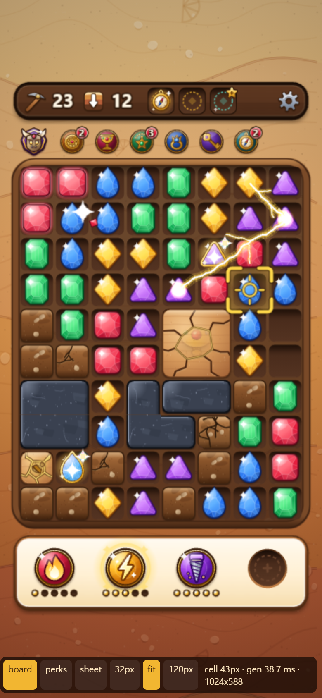

# Gem Rush

A portrait, touch-first web puzzle game. Tap a group of 2 or more connected same-colour gems to clear it. Each clear digs down through layers of strata, and the goal is to unearth relics before you run out of moves.



- **Gem powers:** clearing 6 or more gems charges a power of that colour. There are 5 kinds (Wildfire, Tidal Wave, Earthshaker, Chain Lightning, Drill), each with levels 1 to 5.
- **Obstacles:** dirt takes several hits to clear. Relics sit inside a crust that breaks after 2 chips. Only powers can break bedrock slabs.
- **Boons and perks:** relics grant boons that last for the current level. Between levels you spend progress on four perk paths (Jeweler, Archaeologist, Alchemist, Blacksmith), and you can respec them.
- **Randomness:** every attempt re-rolls the colours, bonus relics, relic types and geodes. Levels 5, 10, 15 and 20 are boss levels.

The first release targets a CrazyGames **Basic Launch**. A mobile build is planned later, as a Capacitor wrapper around the same code.

## Status

The MVP is playable. The current branch rebalances the gem powers after the owner's playtests:

- Earthshaker sends out random fissures and hits dirt less hard at low levels.
- Drill bores deeper and breaks through sideways on its last row.

The power previews and effects were updated to match. See `docs/spec.md` for the full scope.

## Quick start

Requires Node 24 LTS (see `.nvmrc`) and npm 11.

```sh
npm install
npm run dev          # http://localhost:5173  (add ?debug=1 for the debug overlay and keys)
```

| Command | What it does |
|---|---|
| `npm run build` | Typecheck, then build a production bundle with relative paths into `dist/` |
| `npm test` | Vitest unit tests |
| `npm run e2e` | Playwright smoke tests (phone portrait and desktop). First time: `npx playwright install chromium` |
| `npm run check` | Typecheck, lint, test, build, size budget and IP scan in one go |

## Tech

TypeScript (strict), Vite 8, Phaser 4.2.1, Vitest and Playwright.

All art is drawn in code and all sound is synthesized at runtime, so the game ships no audio files. The first download has to stay under 8 MB, and CI enforces this with `size-limit`. There is no backend, no account system and no purchases. Saves stay on the device.

```
src/core/       pure game rules (no Phaser, no DOM; the lint config enforces this)
src/game/       Phaser scenes and views
src/platform/   save, ads, audio and CrazyGames interfaces and implementations
src/telemetry/  local-only playtest event log
```

## Docs

- `docs/spec.md`: the game design spec and the source of truth for scope
- `docs/architecture.md`: how the code fits together
- `CLAUDE.md`: working rules for contributors and agents (IP rules, asset rules, budgets)
- `ASSETS.md` and `THIRD_PARTY.md`: shipped assets, third-party code and their licences

## Licence

The code is under the MIT licence (see `LICENSE`). Owner-provided art is not covered by that licence (see `ASSETS.md`).
